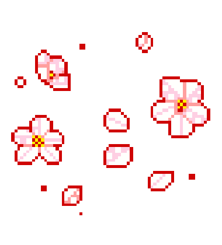

# Olá mundo! 👋

### Sobre mim
Sou acadêmica de **Ciência da Computação na Universidade Federal do Amapá (UNIFAP)** e entusiasta da área de tecnologia, com foco em desenvolvimento web, engenharia de dados e inteligência artificial. Atualmente, sou **Residente Tecnológica** no **Tribunal de Justiça do Amapá (TJAP)**, e **Residente em TIC** pelo programa **IndustrIA**, com foco em Inteligência Artificial.

 

## Habilidades Técnicas

#### **Desenvolvimento Web**

#### **Engenharia de Dados & IA**

---

  Desenvolvido por Daniela Sepeda ✨

